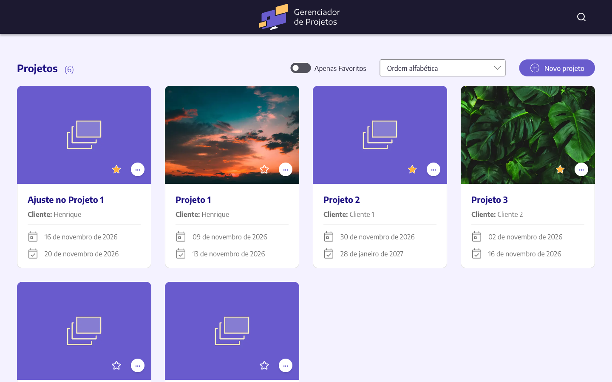

# Gerenciador de Projetos

Aplicação web para cadastrar e acompanhar projetos: nome, cliente, datas de
início e fim e uma imagem de capa. Feita com Next.js, a partir de um conjunto de
designs de desktop.

**Deploy:** https://hseffrin-project-manager.vercel.app/



## Funcionalidades

- **Lista de projetos** em cards, com a quantidade total no título.
- **Favoritos:** a estrela de cada card marca o projeto.
- **Filtros, ordenação e busca** na lista (veja a tabela abaixo).
- **Criar e editar** projetos:
  - validação no navegador e no servidor (o nome precisa ter ao menos duas
    palavras, e a data final não pode ser antes da data de início);
  - capa opcional, em `.jpg` ou `.png` de até 4 MB, com barra de progresso e
    pré-visualização.
- **Remover** projetos, com confirmação. A capa é apagada junto.
- **Carregamento:** skeletons no formato dos cards e do formulário enquanto os
  dados chegam.

### Filtros

| Filtro           | O que faz                                                                                                                                                  | Na URL                                               |
| ---------------- | ---------------------------------------------------------------------------------------------------------------------------------------------------------- | ---------------------------------------------------- |
| Apenas Favoritos | Mostra só os projetos marcados com a estrela.                                                                                                              | `?favoritos=1`                                       |
| Ordenação        | Ordem alfabética, início mais próximo ou fim mais próximo.                                                                                                 | `?ordem=alfabetica`, `?ordem=inicio` ou `?ordem=fim` |
| Busca            | Procura no nome do projeto e do cliente enquanto você digita, a partir de 3 letras, ignorando acentos e maiúsculas. Destaca o trecho encontrado nos cards. | `/search?q=…`                                        |

Os filtros rodam no navegador, sem nova requisição ao servidor. Como ficam na
URL, dá para compartilhar o link, e o "Voltar" do navegador funciona. A busca
guarda as 5 últimas pesquisas no navegador.

## Tecnologias

- [Next.js 16](https://nextjs.org) (App Router, Server Actions e Cache
  Components) com React 19 e TypeScript.
- [Tailwind CSS 4](https://tailwindcss.com), com as cores do design como tokens
  em `src/app/globals.css`, e a fonte Encode Sans.
- [Radix UI](https://www.radix-ui.com) para os componentes acessíveis:
  formulário, switch, select, popover, modal, toggle e barra de progresso.
- [Prisma 7](https://www.prisma.io) com PostgreSQL.
- [Vercel Blob](https://vercel.com/docs/storage/vercel-blob) para as capas.
- [Zod](https://zod.dev) para validar os dados no servidor.
- [react-dropzone](https://react-dropzone.js.org) para o upload e
  [react-loading-skeleton](https://github.com/dvtng/react-loading-skeleton)
  para os skeletons.

## Como rodar

### Pré-requisitos

- Node.js 20.9 ou mais novo.
- [pnpm](https://pnpm.io).
- Um banco PostgreSQL.
- Um store do Vercel Blob com acesso público (Vercel > Storage > Blob).

### Passo a passo

1. Instale as dependências. O `postinstall` já gera o cliente do Prisma.

   ```bash
   pnpm install
   ```

2. Crie o `.env.local` a partir do exemplo e preencha `DATABASE_URL` e
   `BLOB_READ_WRITE_TOKEN`:

   ```bash
   cp .env.example .env.local
   ```

3. Crie as tabelas no banco:

   ```bash
   pnpm prisma db push
   ```

4. Suba o servidor de desenvolvimento e abra http://localhost:3000:

   ```bash
   pnpm dev
   ```

Em desenvolvimento, os arquivos enviados vão para a pasta `test/` do Blob, para
não se misturarem com os de produção caso o store seja o mesmo (veja
[Arquivos no Blob](#arquivos-no-blob)).

### Scripts

| Comando             | O que faz                                  |
| ------------------- | ------------------------------------------ |
| `pnpm dev`          | Servidor de desenvolvimento.               |
| `pnpm build`        | Build de produção.                         |
| `pnpm start`        | Sobe o build de produção.                  |
| `pnpm lint`         | ESLint.                                    |
| `pnpm typecheck`    | Checagem de tipos (`tsc --noEmit`).        |
| `pnpm format`       | Formata o projeto com o Prettier.          |
| `pnpm format:check` | Confere a formatação sem alterar arquivos. |

## Estrutura

```
src/
├── actions/      Server Actions (projetos e uploads)
├── app/          Rotas: / (lista), /new, /edit/[publicId], /search e /api/upload
├── components/   Componentes de interface, um por pasta
├── db/           Schema do Prisma (models/*.prisma) e cliente do banco
└── utils/        Funções auxiliares: busca, ordenação, datas e upload
```

### Arquivos no Blob

As capas ficam no Vercel Blob, organizadas assim:

```
tmp/
└── <nome>-<sufixo>.jpg        Upload feito no formulário, ainda não salvo
projects/
└── <public_id>/
    └── <nome>-<sufixo>.jpg    Capa do projeto
test/
├── tmp/                       O mesmo, para o ambiente de desenvolvimento
└── projects/
```

- **`tmp/`:** o navegador só pode enviar arquivos para cá. O Blob acrescenta um
  sufixo aleatório ao nome (`dog-a1B2c3.jpg`), para que dois arquivos com o
  mesmo nome não se sobrescrevam.
- **`projects/<public_id>/`:** ao salvar o projeto, o servidor copia a capa de
  `tmp/` para a pasta do projeto, com o mesmo nome, aponta o projeto para a cópia
  e só então apaga o arquivo temporário. Se algo falhar no meio, o projeto nunca
  fica sem capa.
- **Limpeza:**
  - um upload descartado no formulário (lixeira ou outra imagem) é apagado na
    hora, desde que nenhum projeto o use;
  - trocar a capa apaga a anterior;
  - remover o projeto apaga a capa dele;
  - se a página for fechada antes de salvar, o upload continua em `tmp/`. Nada
    limpa essa pasta automaticamente por enquanto.
- **`test/`:** fora da produção (`pnpm dev`), tudo vai para `test/tmp/` e
  `test/projects/`. Assim o desenvolvimento pode usar o mesmo store sem misturar
  arquivos com a produção.

O formulário só aceita URLs desse store e dessas pastas (`tmp/` ou `projects/`
do ambiente atual), então não dá para salvar uma capa apontando para outro
site.

## Decisões técnicas

- **Id público:** cada projeto tem um `public_id` (UUID gerado pelo banco),
  usado nas URLs e nas actions. O id numérico nunca chega ao navegador.
- **Filtro, ordenação e busca no navegador:** a página carrega os projetos uma
  vez, e as mudanças na URL não fazem nova requisição ao servidor. Assim a
  resposta é imediata.
- **Upload direto para o Blob:** o navegador envia a capa direto para o Vercel
  Blob, com um token de curta duração emitido por `/api/upload`. O arquivo não
  passa pelo servidor do app e não esbarra no limite de tamanho das funções.
- **Capas por projeto:** o upload vai para `tmp/` e, ao salvar, é movido para a
  pasta do projeto (veja [Arquivos no Blob](#arquivos-no-blob)).
- **Validação em dobro:** o formulário valida enquanto você preenche, e a Server
  Action valida de novo com Zod antes de gravar.

## Qualidade de código

- Prettier e ESLint, rodados no commit pelo husky com lint-staged, junto com a
  checagem de tipos.
- Mensagens de commit no padrão
  [Conventional Commits](https://www.conventionalcommits.org), com o
  commitizen.

## Deploy

O deploy é feito na [Vercel](https://vercel.com). Configure as mesmas variáveis
do `.env.local` (`DATABASE_URL` e `BLOB_READ_WRITE_TOKEN`) no projeto da Vercel.
